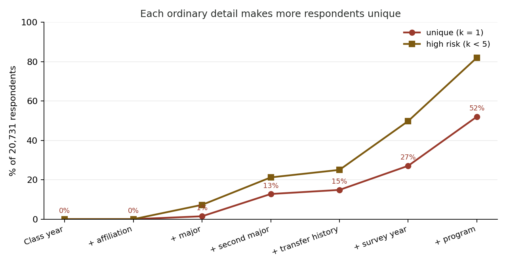
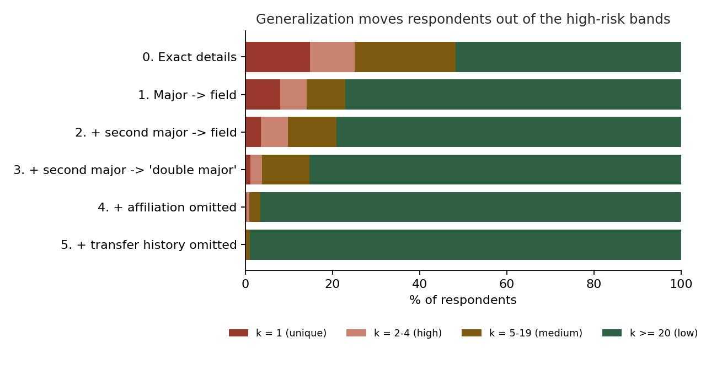

# Re-identification risk in the NSSE synthetic data

Generated by `backend/scripts/risk_report.py` from aggregates over all 20,731 respondents. For each respondent, **k** is how many respondents share exactly the same values on the chosen details (a missing value counts as its own value). k = 1 means the description fits one person.

## 1. Uniqueness grows quickly as ordinary details are added

| Details used | Unique (k = 1) | High risk (k < 5) | Median k |
|---|---|---|---|
| Class year | 0.0% | 0.0% | 9,452 |
| + affiliation | 0.0% | 0.0% | 1,788 |
| + major | 1.5% | 7.3% | 47 |
| + second major | 12.8% | 21.2% | 28 |
| + transfer history | 14.9% | 25.0% | 21 |
| + survey year | 27.1% | 49.8% | 5 |
| + program | 52.1% | 82.0% | 1 |

Survey year and program are not scored by the engine (a thesis rarely states them), but they show how quickly risk compounds when they are.

## 2. k distribution before and after generalization

Each level applies one more rule from `backend/app/risk_config.json` to every respondent.

| Level | k = 1 (unique) | k = 2-4 (high) | k = 5-19 (medium) | k >= 20 (low) |
|---|---|---|---|---|
| 0. Exact details | 3,080 (14.9%) | 2,110 (10.2%) | 4,800 (23.2%) | 10,741 (51.8%) |
| 1. Major -> field | 1,657 (8.0%) | 1,254 (6.0%) | 1,834 (8.8%) | 15,986 (77.1%) |
| 2. + second major -> field | 739 (3.6%) | 1,274 (6.1%) | 2,323 (11.2%) | 16,395 (79.1%) |
| 3. + second major -> 'double major' | 236 (1.1%) | 553 (2.7%) | 2,256 (10.9%) | 17,686 (85.3%) |
| 4. + affiliation omitted | 39 (0.2%) | 132 (0.6%) | 534 (2.6%) | 20,026 (96.6%) |
| 5. + transfer history omitted | 4 (0.0%) | 22 (0.1%) | 173 (0.8%) | 20,532 (99.0%) |

## How to read this

- The data is synthetic and fictional by design (invented majors, lemur species standing in for an identity group), so these are estimates of how identifying such details are, not counts of real students.
- The privacy gate blocks a document while any described participant has k < 5 (high: 1-4, medium: 5-19, low: 20+).
- Generalization trades specificity for safety: each step in section 2 is a sentence the author would have to write less precisely.
